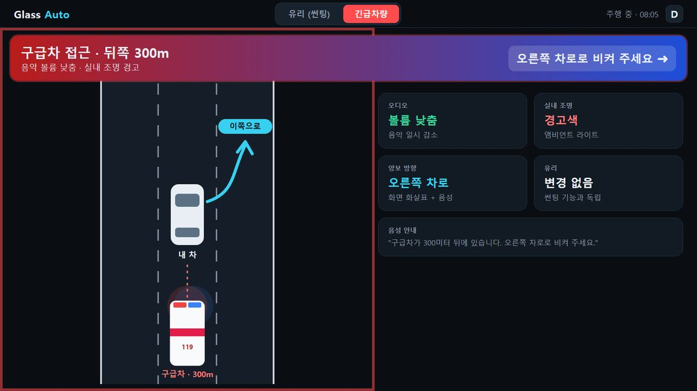
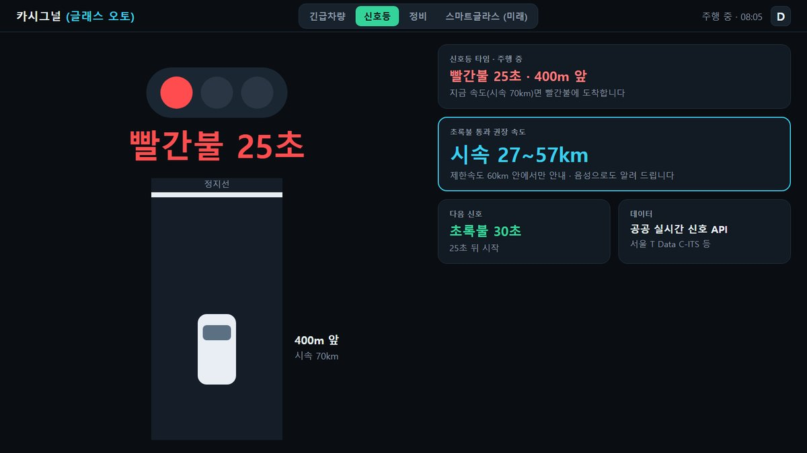
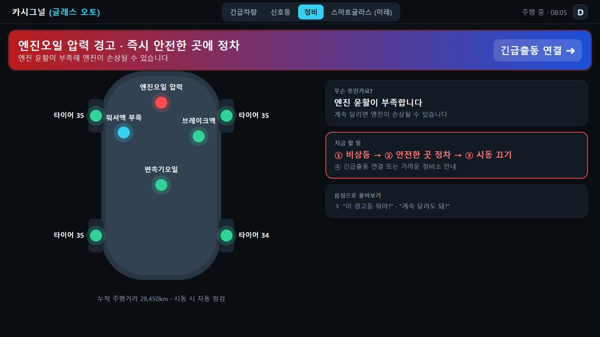
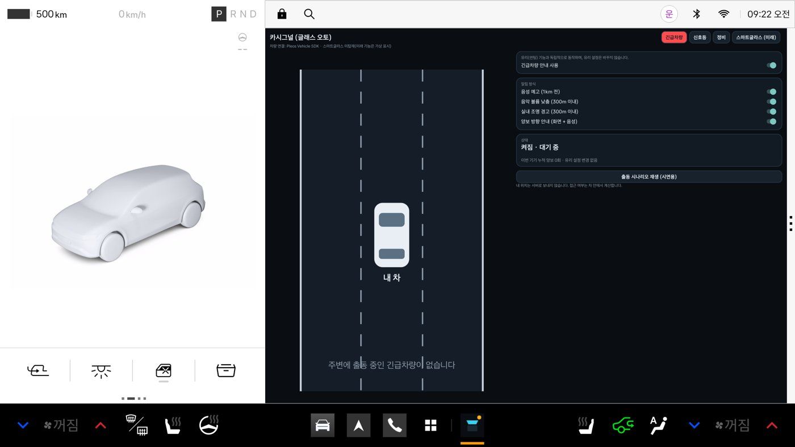
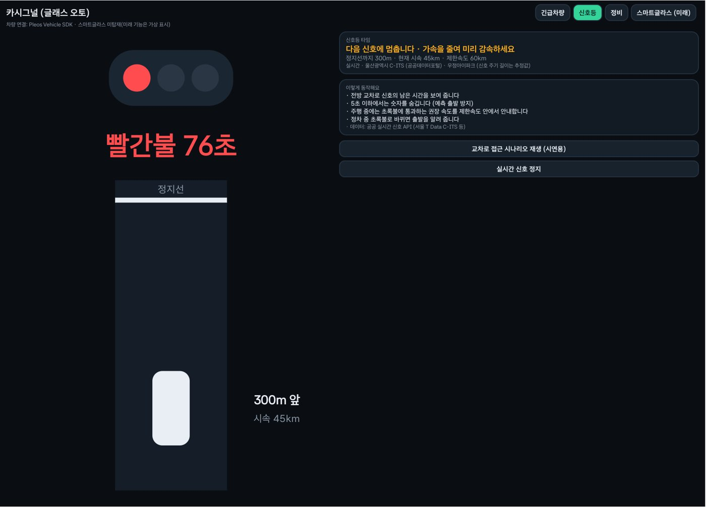
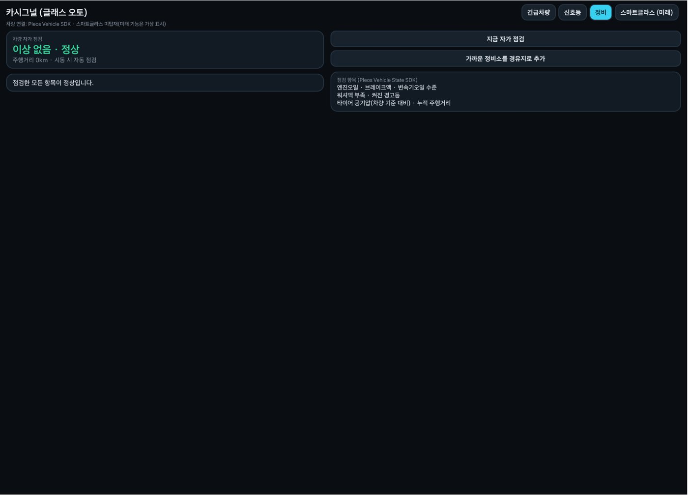
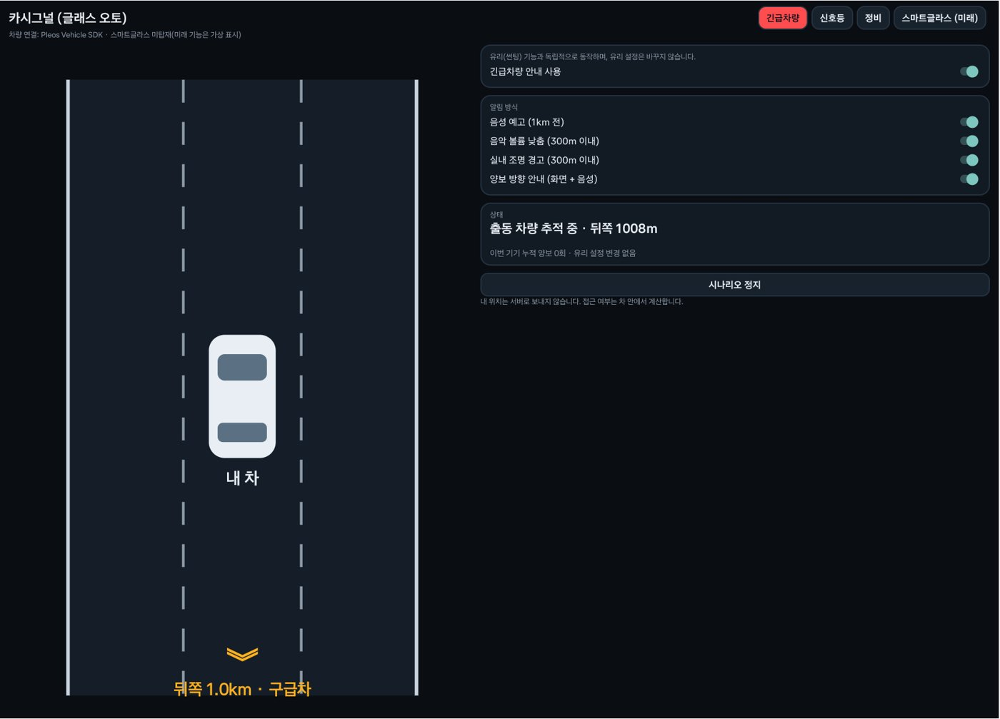

# 카시그널 (글래스 오토) · CarSignal (Glass Auto)

**차 안팎의 신호, 먼저 알려 드립니다.** 다가오는 긴급차량, 앞 신호등의 남은 시간, 차량 경고등과 정비 시기처럼 운전자가 놓치기 쉬운 '신호'를 차가 먼저 읽어 알려 주는 Pleos Connect 차량용 앱입니다.

- **현재 기능 (지금 바로 구현 가능)**: ① 긴급차량 안내 ② 신호등 타임 ③ 오토정비
- **미래 타겟 기능**: 스마트글라스 탑재 차량 출시 후 도입하는 **글래스 오토** (태양 추적 오토 틴트 · 투과율 1% 조절)

> 현대자동차그룹 차량용 앱 개발 공모전 (Code your App into Pleos App Market) 출품작 · 프로토타입 v0.2.0

| 제출물 | 위치 |
|---|---|
| **APK (release)** | [`apk/안도현_CarSignal_release.apk`](apk/) · [Releases v0.2.0](../../releases/tag/v0.2.0) |
| 앱 화면 시안 (11종) | [Releases v0.2.0](../../releases/tag/v0.2.0) 첨부 `CarSignal_screens.pdf` · 미리보기 [`docs/screens/`](docs/screens/) |
| 시연 영상 (나레이션 포함 목업) | [Releases v0.2.0](../../releases/tag/v0.2.0) 첨부 `CarSignal_demo.mp4` |
| 소스 코드 | 이 저장소 (`app/`) |

| 긴급차량 · 300m 접근 안내 | 신호등 타임 · 초록불 통과 속도 | 오토정비 · 경고등 풀이 |
|---|---|---|
|  |  |  |

**Pleos Connect Emulator v2.1.0 실제 실행 화면 (2026-10-28)**

| Pleos 차량 화면 안에서 실행 | 신호등 · 울산 C-ITS 실시간 신호 | 오토정비 · Pleos SDK 실측 | 긴급차량 · 출동 시나리오 |
|---|---|---|---|
|  |  |  |  |

---

## 1. 기능

앱 상단 탭 **[긴급차량] [신호등] [정비] [스마트글라스(미래)]** 로 나뉩니다. 각 기능은 독립 모듈이라 서로의 차량 제어에 관여하지 않습니다.

### 현재 기능 1. 긴급차량 안내
- 긴급차량과 **같은 방향**으로 달리고 내 차가 **그 앞쪽**에 있을 때만 알립니다. 반대 차로·이미 지나간 차량은 알리지 않습니다. (`core/EmergencyMatcher.kt`)
- 약 1km: 음성 예고 → 약 300m: 음악 볼륨 낮춤(오디오 포커스), 실내 조명 경고, 양보 방향 안내 → 통과 후 복귀·양보 기록 (`emergency/AlertController.kt`)
- 알림 방식(음성·볼륨·조명·양보 안내)을 각각 켜고 끌 수 있습니다.
- 개인정보: 일반 차량은 자기 위치를 서버로 보내지 않고, 판정은 차 안에서만 합니다.

### 현재 기능 2. 신호등 타임
- 앞 교차로 신호의 **현재 색과 남은 시간**을 표시합니다.
- **초록불 통과 권장 속도**: 거리와 신호 주기로 초록불에 도착할 수 있는 속도 구간을 계산하고, **제한속도 안의 구간만** 안내합니다. 제한속도를 넘어야 하면 안내하지 않습니다. (`core/TrafficSignal.kt` · `SignalAdvisor`)
- **예측 출발 방지**: 남은 시간이 5초 이하이면 숫자를 숨기고 "곧 바뀝니다"로만 표시합니다.
- **실시간 신호 연결 (구현)**: 울산광역시_C-ITS API(공공데이터포털 `/signal?linkId=`)에서 교차로 신호 색과 남은 초를 받아 화면에 표시합니다. 서울 T Data '신호제어기 신호 잔여시간 정보서비스'도 같은 형식으로 읽습니다(`core/LiveSignal.kt`, `signal/LiveSignalClient.kt`). 신호 색·남은 시간은 실측값, 차량 접근은 시뮬레이션입니다.
- 인증키는 **APK와 저장소에 넣지 않습니다.** `.env`에만 두고, `run.ps1`이 앱 실행 인자로 한 번 넘기면 앱 전용 저장소에 보관합니다. 키가 없으면 시연 시나리오로만 동작합니다.
- 실서비스에서는 서버가 키를 보관하고 호출량을 관리합니다. T Data 신호 API는 같은 API를 **5분에 한 번만** 호출할 수 있고, 울산 API 개발계정은 하루 100회입니다.
- 울산 C-ITS 색 코드는 실측(1 약 150초 → 3 약 20초 → 1)으로 1=빨강, 3=초록으로 판단했습니다. 2(노랑)는 아직 관측하지 못해 활용가이드로 최종 확인이 필요합니다.

### 현재 기능 3. 오토정비
- **자가 점검**: Vehicle SDK로 엔진오일·브레이크액·변속기오일 레벨, 워셔액, 네 바퀴 타이어 공기압, 누적 주행거리를 읽어 **정상 / 점검 권장 / 정비소 방문 / 즉시 정차** 4단계로 정리합니다. (`core/Maintenance.kt` · `MaintenanceAdvisor`)
- **경고등 풀이**: 켜진 경고등(텔테일)의 뜻·긴급도·지금 할 일을 알려 줍니다. 엔진, 오일 압력, 냉각수 온도, TPMS, ABS, ESC, 에어백, 조향(MDPS), 12V 배터리 등 18종. (`WarningLightGuide`)
- **소모품 주기**: 마지막 엔진오일 교체 후 주행거리로 교체 시기(10,000km 기준, 1,000km 전부터 안내)를 계산합니다.

### 미래 타겟 기능. 스마트글라스 (글래스 오토)
스마트글라스 탑재 차량이 출시되면 도입합니다. 판단 로직과 화면은 구현되어 있고, 지금은 **가상 유리**로 결과를 보여 줍니다.
- **오토 틴트**: 태양의 방위각·고도를 계산해 햇빛이 닿는 유리만 어둡게 합니다. (`core/SunEngine.kt`)
- **투과율 1% 세밀 조절**: 유리별 1% 단위 조절. 차량 단계 수에 맞춰 가장 가까운 단계로 변환하고 **차량 적용값**을 표시합니다. (`LevelMapper`)
- **법규 가드**: 주행 중 앞유리 70%, 1열 옆유리 40% 미만으로 내리지 않습니다 (도로교통법 시행령 제28조). 우선순위 **법규 가드 > 시야 우선 > 수동 > 자동** (`core/GlassPolicy.kt`)

---

## 2. 실행 방법

### APK 바로 설치
1. Pleos Connect Emulator(또는 Android 9 이상 기기)를 실행합니다.
2. `apk/안도현_CarSignal_release.apk` 를 설치합니다.
   ```
   adb install -r apk/안도현_CarSignal_release.apk
   ```
3. 앱 목록에서 **카시그널 (글래스 오토)** 를 실행합니다.

### 소스에서 빌드 (Windows PowerShell)
```powershell
.\setup.ps1       # JDK 17, Android SDK(플랫폼 34, 빌드 도구 34.0.0) 설치 — 처음 한 번
.\build-apk.ps1   # 단위 테스트 → release APK 빌드 → apk\ 폴더에 복사
.\run.ps1         # 연결된 에뮬레이터/기기에 설치 후 실행
```
macOS/Linux: `./gradlew testReleaseUnitTest assembleRelease` (JDK 17, `ANDROID_HOME` 필요)

## 3. 테스트 환경 및 필요한 설정

| 항목 | 내용 |
|---|---|
| 대상 플랫폼 | Pleos Connect (Android Automotive 기반), minSdk 28 / targetSdk 34 |
| 권장 에뮬레이터 | Pleos Connect Emulator v2.1.0 (Android Studio SDK Manager에 Pleos 시스템 이미지 추가) |
| SDK | `ai.pleos.playground:Vehicle:2.3.2` (공개 Maven: `nexus-playground.pleos.ai`) |
| 빌드 도구 | JDK 17, Android Gradle Plugin 8.5.2, Gradle 8.7, Kotlin 1.9.25 |
| 별도 계정·키 | 프로토타입 실행에는 필요 없음. 실시간 신호를 보려면 `.env`에 `DATA_GO_KR_SERVICE_KEY`(울산 C-ITS) 또는 `TDATA_API_KEY`(서울 T Data)를 넣고 `run.ps1`로 실행 (`.env.example` 참고) |
| 실행 확인 | 2026-10-28 Pleos Connect Emulator v2.1.0(API 34)에서 설치·실행 확인. 16GB RAM 권장 (8GB PC에서는 부팅은 되지만 부하로 시스템 서비스가 재시작되기도 함) |

**차량 연결 방식**
- Pleos 차량 서비스가 있는 기기에서는 `PleosVehicleGateway`가 Vehicle SDK로 **기어·좌석 탑승**을 구독하고, **Safety**(오일·브레이크액·변속기오일·워셔액·경고등), **Tire**(바퀴별 공기압·저압 기준), **Odometer**(주행거리)를 조회합니다. 스마트글라스는 `checkSmartGlassLevelCapabilities`로 지원 여부를 확인한 뒤 `setSmartGlassLevel`로 적용합니다.
- Pleos 서비스가 없는 환경(일반 에뮬레이터 포함)에서는 **시뮬레이션 모드**로 동작합니다. 화면 상단에 현재 연결 상태가 표시됩니다.

**시연 방법**
- 긴급차량 탭 **출동 시나리오 재생**: 구급차가 1.4km 뒤에서 접근해 추월하는 과정을 3배속으로 재생합니다.
- 신호등 탭 **교차로 주행 재생**: 빨간불 18초 · 380m 앞에서 출발해 권장 속도 안내와 정지선 정차, 5초 숨김을 2배속으로 보여 줍니다.
- 신호등 탭 **실시간 신호 받기**: 키가 있을 때만 나타납니다. 울산 우정아이파크 교차로의 지금 신호와 남은 시간을 받아 오고, 남은 시간이 끝나면 다시 받습니다.
- 정비 탭 **시뮬레이터 토글**: 엔진오일 부족, 타이어 저압, 워셔액 부족, 엔진 경고등, 엔진오일 압력 경고등을 켜고 "지금 자가 점검"을 누르면 결과가 바뀝니다. (Pleos 차량에 연결되면 실제 값을 읽습니다. 에뮬레이터는 경고등·저압 기준·주행거리만 제공하고 오일·브레이크액·워셔액·공기압 값은 'not supported'로 응답합니다.)

> 2026-10-25 기준 Pleos Playground에서 **Vehicle State(조회)·NaviHelper는 사용 가능**, **Vehicle Control(제어)·FusedLocation·TTS·STT는 '준비 중'**입니다. 오토정비는 조회 API만 쓰므로 지금 동작하고, 제어가 필요한 부분은 지원 여부를 먼저 확인한 뒤 미지원이면 화면 안내·가상 유리로 대체합니다. 음성은 Android 표준 TextToSpeech를 사용합니다.

## 4. 구조

```
app/src/main/java/io/github/glassauto/
  core/         차량과 무관한 판단 로직 (단위 테스트 대상)
    EmergencyMatcher.kt   긴급차량 접근 판정(같은 방향·전방·거리 단계)
    TrafficSignal.kt      신호 남은 시간 표시 규칙 · 초록불 통과 속도 구간
    Maintenance.kt        점검 판정(4단계 긴급도) · 경고등 풀이 · 오일 교체 주기
    LiveSignal.kt         공공 신호 API 응답 해석 (울산 C-ITS · 서울 T Data)
    SunEngine.kt          (미래) 태양 위치(NOAA 간이식) · 유리별 일사 노출
    Glass.kt              (미래) 유리 위치 · 기어 · 썬팅 법규(LegalProfile)
    GlassPolicy.kt        (미래) 유리 우선순위 엔진 · 1% → 차량 단계 변환(LevelMapper)
  vehicle/      차량 접근 계층
    PleosVehicleGateway.kt     Pleos Vehicle SDK 연결 (Gear, Seat, Safety, Tire, Odometer, Window, Light)
    SimulatedVehicleGateway.kt 시뮬레이션 (가상 차량 상태 · 가상 유리)
  signal/       공공 실시간 신호 API 호출 (키는 앱 전용 저장소에만)
  emergency/    긴급차량 기능
    AlertController.kt    음성 예고 · 오디오 포커스(볼륨 낮춤) · 조명 경고 · 양보 기록
    EmergencySimulator.kt 출동 시나리오 재생 (실서비스에서는 WebSocket 수신으로 대체)
  ui/           화면 (긴급차량 / 신호등 / 정비 / 스마트글라스(미래) 탭)
app/src/test/   단위 테스트 (JUnit4)
```

## 5. 단위 테스트 (41개)

`.\build-apk.ps1` 또는 `./gradlew testReleaseUnitTest` 로 실행합니다.

| 테스트 | 확인 내용 |
|---|---|
| `EmergencyMatcherTest` | 1km 예고·300m 경보, 추월 후 통과, 반대 차로·전방 차량 제외 |
| `SignalAdvisorTest` | 5초 이하 숨김, 초록불 안 도착 시 속도 유지, 빨간불 → 초록불 도착 속도 범위, 제한속도 클램프, 노란불 다음 초록 구간, 신호 주기 전환 |
| `LiveSignalTest` | 울산 C-ITS·서울 T Data 실제 응답 형식 해석, 1/10초 단위, 최신 메시지 선택, 받은 뒤 경과 시간 반영 |
| `MaintenanceAdvisorTest` | 이상 없음 → 정상, 엔진오일 압력 경고등 → 즉시 정차(최우선), 브레이크액·엔진오일 부족, 바퀴별 타이어 저압, 오일 교체 주기, 경고등 사전 |
| `SunEngineTest` | 서울 하지 정오·동지 일몰 무렵·한밤 태양 위치, 상대 각도, 유리별 노출 |
| `GlassPolicyTest` | 법규 하한, P단 해제, 수동 우선, 수동 vs 법규, 후진·와이퍼 시야 우선, 프라이버시 |
| `LevelMapperTest` | 1% 입력 → 차량 단계 변환과 실제 적용값 (101단계·5단계·역방향·단일 단계) |

## 6. 알려진 한계 · 다음 단계 (2차 PT까지)

- 신호 API 중계 서버(키 보관·호출량 관리)와 NaviHelper 경로상 교차로 매칭 — 현재는 울산 예시 교차로 1곳을 앱이 직접 조회
- 정비소 경유지 추가(NaviHelper) — 현재는 버튼과 안내 메시지까지
- 긴급차량 위치 중계 서버(WebSocket)와 출동 모드 인증(기관 계정 + VIN) — 현재는 시나리오 재생기
- 음성 질의("이 경고등 뭐야?") — TTS/STT SDK 공개 후
- Pleos 에뮬레이터에서 설치·실행·Pleos SDK 연결·실시간 신호 표시까지 확인했습니다(2026-10-28). 이때 찾은 정비 권한 누락(`CAR_SAFETY`, `PRIVATE_CAR_SAFETY`)과 본문 레이아웃 높이 0 버그를 고쳤습니다.

---

<details>
<summary>개발자 메모 (두 PC 공용 작업 규칙)</summary>

- 경로를 코드에 직접 쓰지 않습니다. JDK·SDK 위치는 `tools/android-env.ps1` 이 사용자 폴더 기준으로 찾습니다.
- 설치는 `setup.ps1`, 빌드는 `build-apk.ps1`, 실행은 `run.ps1`.
- 서명 키 비밀번호는 `.env` 에만 두고(`.env.example` 참고), 키 파일은 동기화 폴더 `env\glass-auto\release.jks` 에 보관합니다. 키가 없으면 debug 키로 서명합니다.
- `ws save "메모"` / `ws pull` / `ws handoff`
</details>
