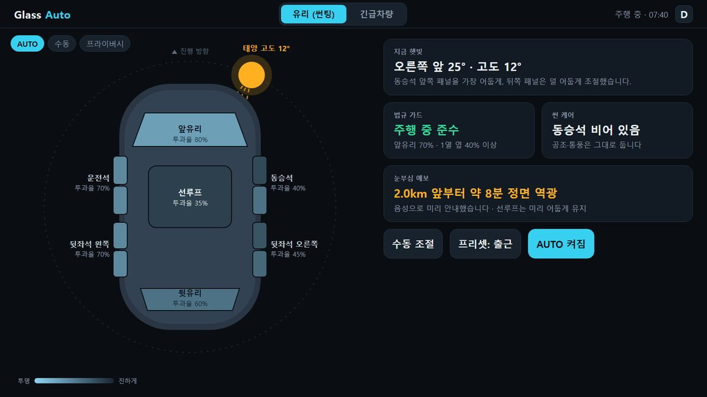
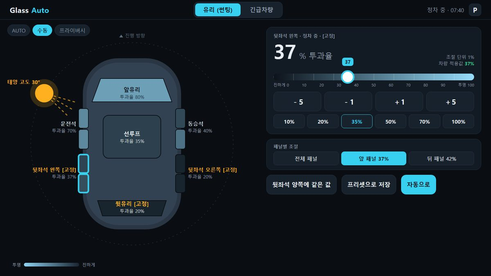

# 글래스 오토 (Glass Auto)

**햇빛은 가리고, 위험은 보이게.** 태양 위치에 맞춰 차량 유리 투과율을 자동으로 또는 1% 단위로 직접 조절하는 **유리 기능**과, 다가오는 긴급차량을 미리 알려 양보를 돕는 **긴급차량 안내 기능**을 독립된 두 기능으로 담은 Pleos Connect 차량용 앱입니다.

> 현대자동차그룹 차량용 앱 개발 공모전 (Code your App into Pleos App Market) 출품작 · 프로토타입 v0.1.0

| 제출물 | 위치 |
|---|---|
| **APK (release)** | [`apk/안도현_GlassAuto_release.apk`](apk/) · [Releases v0.1.0](../../releases/tag/v0.1.0) |
| 앱 화면 시안 (11종) | [Releases v0.1.0](../../releases/tag/v0.1.0) 첨부 `GlassAuto_screens.pdf` · 미리보기 [`docs/screens/`](docs/screens/) |
| 시연 영상 (나레이션 포함 목업) | [Releases v0.1.0](../../releases/tag/v0.1.0) 첨부 `GlassAuto_demo.mp4` |
| 소스 코드 | 이 저장소 (`app/`) |

| 유리 · 오토 틴트 | 유리 · 투과율 1% 세밀 조절 | 긴급차량 · 300m 접근 안내 |
|---|---|---|
|  |  |  |

---

## 1. 두 가지 독립 기능

앱 상단 탭으로 나뉘며, 서로 다른 기능의 차량 제어에 관여하지 않습니다. 긴급차량이 접근해도 유리 설정은 바뀌지 않습니다.

### 기능 1. 유리 (썬팅)
- **오토 틴트**: 위치·진행 방향·시각으로 태양의 방위각·고도를 계산해 햇빛이 닿는 유리만 어둡게 합니다. (`core/SunEngine.kt`)
- **투과율 세밀 조절**: 유리별로 1% 단위 조절 (슬라이더, −5·−1·+1·+5, 빠른 값). 수동으로 정한 유리는 [고정]되어 자동 조절에서 빠집니다.
- **법규 가드**: 주행 중 앞유리 70%, 1열 옆유리 40% 미만으로 내리지 않습니다 (도로교통법 시행령 제28조). P단에서는 제한을 풉니다.
- **시야 우선 규칙**: 후진 시 뒤·옆 유리, 와이퍼 작동 시 앞유리를 투명하게.
- **프라이버시 모드**: P단에서만 전체 유리를 어둡게, 출발하면 자동 해제.
- 우선순위: **법규 가드 > 시야 우선 > 수동 > 자동** (`core/GlassPolicy.kt`)
- 차량마다 다른 스마트글라스 단계 수에 맞춰 1% 입력값을 가장 가까운 단계로 변환하고 **차량 적용값**을 표시합니다. (`LevelMapper`)

### 기능 2. 긴급차량 안내
- 긴급차량과 **같은 방향**으로 달리고 내 차가 **그 앞쪽**에 있을 때만 알립니다. 반대 차로·이미 지나간 차량은 알리지 않습니다. (`core/EmergencyMatcher.kt`)
- 약 1km: 음성 예고 → 약 300m: 음악 볼륨 낮춤(오디오 포커스), 실내 조명 경고, 양보 방향 안내 → 통과 후 복귀·양보 기록 (`emergency/AlertController.kt`)
- 알림 방식(음성·볼륨·조명·양보 안내)을 각각 켜고 끌 수 있습니다.
- 개인정보: 일반 차량은 자기 위치를 서버로 보내지 않고, 판정은 차 안에서만 합니다.

---

## 2. 실행 방법

### APK 바로 설치
1. Pleos Connect Emulator(또는 Android 9 이상 기기)를 실행합니다.
2. `apk/안도현_GlassAuto_release.apk` 를 설치합니다.
   ```
   adb install -r apk/안도현_GlassAuto_release.apk
   ```
3. 앱 목록에서 **글래스 오토**를 실행합니다.

### 소스에서 빌드 (Windows PowerShell)
```powershell
.\setup.ps1       # JDK 17, Android SDK(플랫폼 34, 빌드 도구 34.0.0) 설치 — 처음 한 번
.\build-apk.ps1   # 단위 테스트 → release APK 빌드 → apk\ 폴더에 복사
.\run.ps1         # 연결된 에뮬레이터/기기에 설치 후 실행
```
macOS/Linux: `./gradlew testReleaseUnitTest assembleRelease` (JDK 17, `ANDROID_HOME` 필요)

## 3. 테스트 환경 및 필요한 설정

| 항목 | 내용 |
|---|---|
| 대상 플랫폼 | Pleos Connect (Android Automotive 기반), minSdk 28 / targetSdk 34 |
| 권장 에뮬레이터 | Pleos Connect Emulator v2.1.0 (Android Studio SDK Manager에 Pleos 시스템 이미지 추가) |
| SDK | `ai.pleos.playground:Vehicle:2.3.2` (공개 Maven: `nexus-playground.pleos.ai`) |
| 빌드 도구 | JDK 17, Android Gradle Plugin 8.5.2, Gradle 8.7, Kotlin 1.9.25 |
| 별도 계정·키 | 필요 없음 (실행에 로그인·API 키 불필요) |

**차량 연결 방식**
- Pleos 차량 서비스가 있는 기기에서는 `PleosVehicleGateway`가 Vehicle SDK로 **기어**와 **좌석 탑승**을 조회·구독하고, `checkSmartGlassLevelCapabilities`로 스마트글라스 지원 유리와 단계 범위를 확인한 뒤 `setSmartGlassLevel`로 투과율을 적용합니다.
- Pleos 서비스가 없거나 스마트글라스를 지원하지 않는 환경(일반 에뮬레이터 포함)에서는 **시뮬레이션 모드**로 동작하며, 화면의 **가상 유리**에 결과를 표시합니다. 화면 상단에 현재 연결 상태가 표시됩니다.
- Pleos Virtual Console에서 기어(P/R/D)를 바꾸면 법규 가드·시야 우선 규칙이 바로 반응합니다.

**시연 방법**
- 유리 탭 아래 **시연용 시뮬레이터**: 진행 방향·시각(05:00~20:00)을 바꾸면 서울 기준 실제 태양 위치가 다시 계산되고, 기어 P/R/D·와이퍼로 규칙을 확인할 수 있습니다.
- 긴급차량 탭의 **출동 시나리오 재생**: 구급차가 1.4km 뒤에서 접근해 추월하는 과정을 3배속으로 재생합니다(약 40초).

> 2026-10-25 기준 Pleos Playground에서 **Vehicle State(조회)·NaviHelper는 사용 가능**, **Vehicle Control(제어)·FusedLocation·TTS·STT는 '준비 중'**입니다. 그래서 제어 호출은 지원 여부를 먼저 확인하고, 미지원이면 가상 유리로 대체합니다. 음성은 Android 표준 TextToSpeech를 사용합니다.

## 4. 구조

```
app/src/main/java/io/github/glassauto/
  core/         차량과 무관한 판단 로직 (단위 테스트 대상)
    SunEngine.kt          태양 위치(NOAA 간이식) · 유리별 일사 노출 · 자동 투과율
    Glass.kt              유리 위치 · 기어 · 지역별 썬팅 법규(LegalProfile) · 법규 가드
    GlassPolicy.kt        유리 우선순위 엔진 · 1% → 차량 단계 변환(LevelMapper)
    EmergencyMatcher.kt   긴급차량 접근 판정(같은 방향·전방·거리 단계)
  vehicle/      차량 접근 계층
    PleosVehicleGateway.kt     Pleos Vehicle SDK 연결 (Gear, Seat, Window, Light)
    SimulatedVehicleGateway.kt 시뮬레이션 (가상 유리)
  emergency/    긴급차량 기능 (유리와 독립)
    AlertController.kt    음성 예고 · 오디오 포커스(볼륨 낮춤) · 조명 경고 · 양보 기록
    EmergencySimulator.kt 출동 시나리오 재생 (실서비스에서는 WebSocket 수신으로 대체)
  ui/           화면 (유리 탭 / 긴급차량 탭)
app/src/test/   단위 테스트 (JUnit4)
```

## 5. 단위 테스트

`.\build-apk.ps1` 또는 `./gradlew testReleaseUnitTest` 로 실행합니다.

| 테스트 | 확인 내용 |
|---|---|
| `SunEngineTest` | 서울 하지 정오·동지 일몰 무렵·한밤 태양 위치, 상대 각도, 유리별 노출 |
| `GlassPolicyTest` | 법규 하한, P단 해제, 수동 우선, 수동 vs 법규, 후진·와이퍼 시야 우선, 프라이버시 |
| `LevelMapperTest` | 1% 입력 → 차량 단계 변환과 실제 적용값 (101단계·5단계·역방향·단일 단계) |
| `EmergencyMatcherTest` | 1km 예고·300m 경보, 추월 후 통과, 반대 차로·전방 차량 제외 |

## 6. 알려진 한계 · 다음 단계 (2차 PT까지)

- 스마트글라스 **패널(구역) 단위 제어**(`setSmartGlassZoneState`)와 좌석 통풍(썬 케어) 연결
- 긴급차량 위치 중계 서버(WebSocket)와 출동 모드 인증(기관 계정 + VIN) — 현재는 시나리오 재생기로 시연
- 내비 경로(NaviHelper) 기반 눈부심 예보·경로 매칭 — 현재는 방향·거리 기준 판정
- Gleo AI App Schema 음성 명령 연동

---

<details>
<summary>개발자 메모 (두 PC 공용 작업 규칙)</summary>

- 경로를 코드에 직접 쓰지 않습니다. JDK·SDK 위치는 `tools/android-env.ps1` 이 사용자 폴더 기준으로 찾습니다.
- 설치는 `setup.ps1`, 빌드는 `build-apk.ps1`, 실행은 `run.ps1`.
- 서명 키 비밀번호는 `.env` 에만 두고(`.env.example` 참고), 키 파일은 동기화 폴더 `env\glass-auto\release.jks` 에 보관합니다. 키가 없으면 debug 키로 서명합니다.
- `ws save "메모"` / `ws pull` / `ws handoff`
</details>
